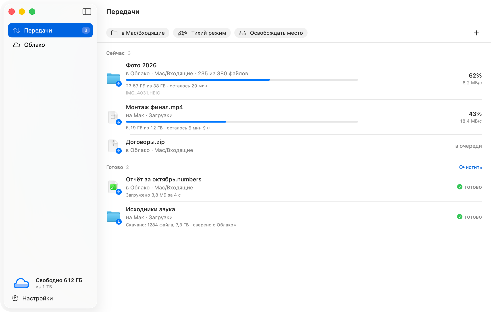
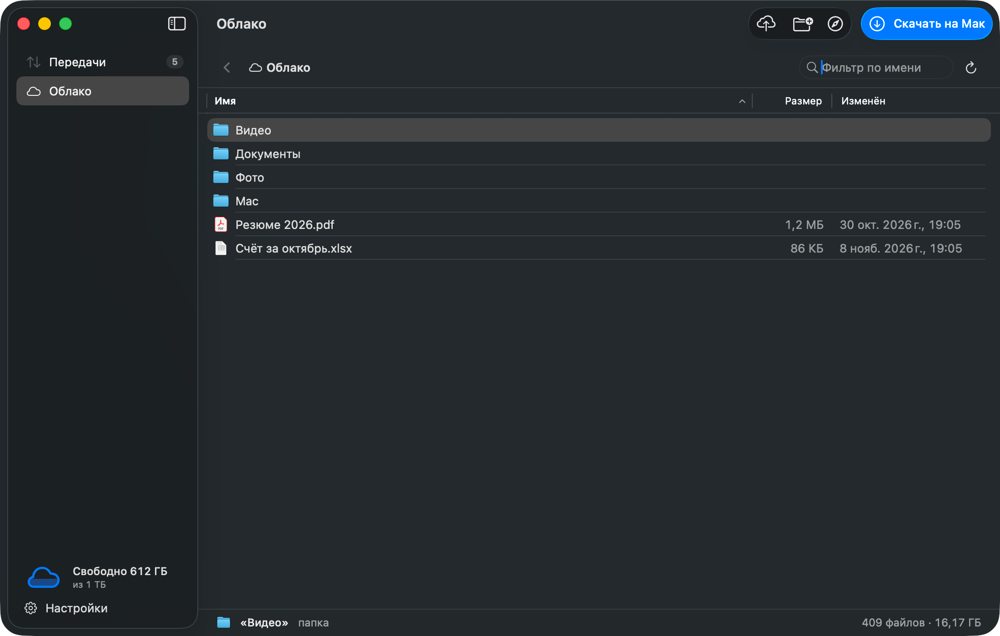
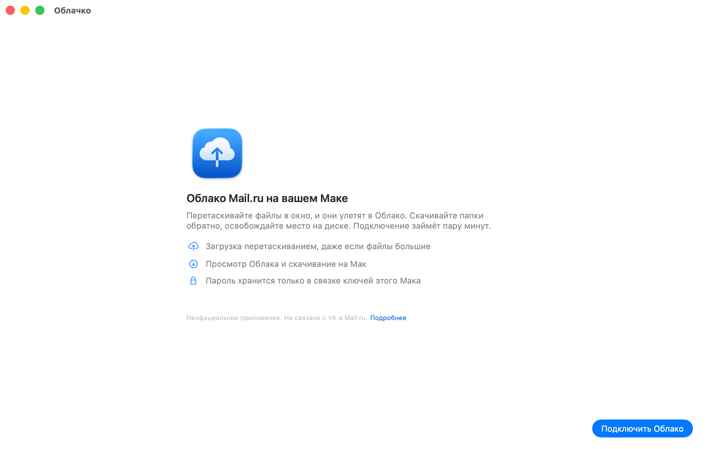
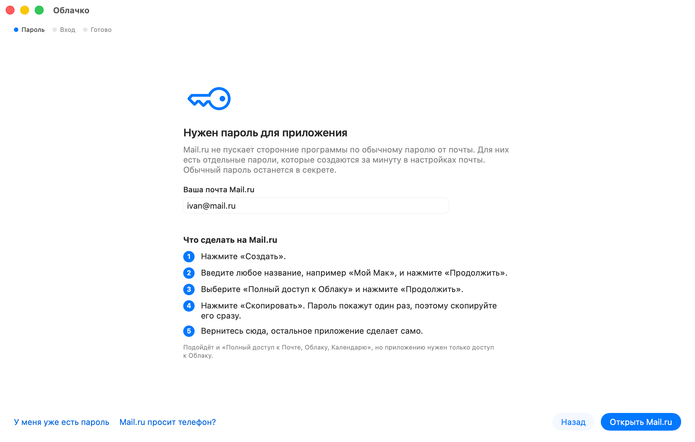
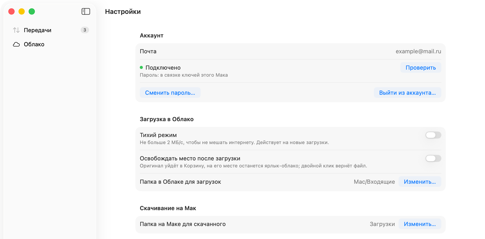

# Облачко: клиент Облака Mail.ru для macOS

Нативное приложение для Мака, которое загружает файлы в Облако Mail.ru, скачивает их обратно и освобождает место на диске. SwiftUI снаружи, [rclone](https://rclone.org) внутри.

**Неофициальный клиент, не связан с VK / Mail.ru.** «Облако Mail.ru» и «Mail.ru» здесь только названия сервиса, с которым работает приложение.

[Скачать последнюю версию](https://github.com/BLHN/mailru-cloud-mac/releases/latest) · macOS 14 и новее · Apple Silicon и Intel · [English below](#english)

<p align="center">
  <picture>
    <source media="(prefers-color-scheme: dark)" srcset="docs/screenshots/transfers-dark.png">
    
  </picture>
</p>

## Что умеет

- **Загрузка перетаскиванием.** Бросьте файлы или папки в окно, на иконку в Доке или выберите в Finder «Службы → Отправить в Облако Mail.ru». Большие папки идут в несколько потоков, прогресс виден в окне, в меню-баре и на иконке в Доке.
- **Просмотр Облака и скачивание на Мак.** Папки Облака видны в окне приложения, их можно открыть и скачать целиком.
- **Освобождение места.** После загрузки оригинал уходит в Корзину, а на его месте остаётся маленький ярлык `.mailcloud`. Двойной клик по ярлыку возвращает файл из Облака.
- **Тихий режим.** Не больше 2 МБ/с, чтобы загрузка не мешала остальному интернету.
- **Переживает обрывы.** Очередь сохраняется, после пропажи сети и перезапуска загрузки продолжаются сами, а уже загруженные файлы заново не отправляются.

Приложение ничего не удаляет, не переименовывает и не перемещает в самом Облаке.

<p align="center">
  
</p>

## Как установить

1. Откройте [страницу последнего релиза](https://github.com/BLHN/mailru-cloud-mac/releases/latest) и скачайте `Oblachko-<версия>.dmg` (около 72 МБ) или `Oblachko-<версия>.zip`. Внутри архива приложение называется «Облачко».
2. Откройте DMG и перетащите «Облачко» в папку «Программы».
3. Запустите «Облачко» из «Программ». В первый раз macOS скажет, что не может проверить приложение, и предложит только «Готово» или «Переместить в Корзину». Нажмите «Готово».
4. Откройте «Системные настройки → Конфиденциальность и безопасность», прокрутите до раздела «Безопасность». Там будет строка про «Облачко» и кнопка «Открыть всё равно». Нажмите её, затем ещё раз «Открыть всё равно» в появившемся окне и введите пароль от Мака.
5. Дальше приложение открывается как обычно.

Это работает одинаково на macOS 15 Sequoia и macOS 26 Tahoe. Кнопка «Открыть всё равно» появляется только после попытки запуска и держится около часа. Если её нет, запустите приложение ещё раз и снова загляните в настройки.

Если запустить приложение из «Загрузок» или прямо из DMG, оно само предложит перенести себя в «Программы».

**Через Терминал** (вместо шагов 3–4, если вам так привычнее):

```sh
xattr -dr com.apple.quarantine "/Applications/Облачко.app"
```

**Проверка файла.** Рядом с архивами в релизе лежит `SHA256SUMS`. Сравните:

```sh
shasum -a 256 ~/Downloads/Oblachko-<версия>.dmg
```

### Почему нет подписи Apple

Нотаризация Apple стоит $99 в год и из России почти недоступна. Поэтому приложение подписано без сертификата Apple, и macOS при первом запуске просит подтвердить, что вы ему доверяете. Исходный код открыт, релиз собирается из него скриптом `build.sh`.

## Как подключить Облако

При первом запуске приложение само проведёт по шагам. Обычный пароль от почты не подойдёт: Mail.ru пускает сторонние программы только по отдельному **паролю для внешнего приложения**.

<p align="center">
  
  
</p>

1. Введите свою почту Mail.ru и нажмите «Открыть Mail.ru». Откроется страница паролей для внешних приложений (войдите в почту, если попросят).
2. Нажмите «Создать», введите любое название, например «Мой Мак», и нажмите «Продолжить».
3. Выберите «Полный доступ к Облаку» и нажмите «Продолжить». Подойдёт и «Полный доступ к Почте, Облаку, Календарю», но приложению нужен только доступ к Облаку.
4. Нажмите «Скопировать». Пароль покажут один раз, поэтому скопируйте его сразу.
5. Вернитесь в приложение и нажмите «Вставить и подключить». Приложение проверит пароль и покажет, сколько места свободно.

Если Mail.ru просит сначала привязать телефон, привяжите его на [id.mail.ru](https://id.mail.ru/contacts) и вернитесь к шагу 1. Иногда вместо создания пароля Mail.ru предлагает подписку Mail Space: это правило самого Mail.ru для части ящиков, и приложение его не обойдёт.

**Если rclone уже настроен.** Если в вашем `~/.config/rclone/rclone.conf` есть remote с именем `mailru`, приложение работает через него и ничего не меняет в конфиге. В «Настройки → Аккаунт» можно перейти на вход внутри приложения.

## Приватность

- Пароль для приложения хранится только в связке ключей вашего Мака (запись «Облачко: Облако Mail.ru»).
- Если пароль вставлен кнопкой «Вставить», после успешного входа приложение убирает его из буфера обмена (если вы с тех пор ничего другого не скопировали).
- Пароль уходит только на Mail.ru (`webdav.cloud.mail.ru`). Встроенный rclone получает его через переменные окружения своего процесса, не через командную строку и не через файл на диске.
- Никакой телеметрии, аналитики, проверки обновлений и других серверов. Страницы Mail.ru и GitHub открываются в браузере, только когда вы нажимаете кнопку.
- Журнал лежит в `~/Library/Logs/CloudMail.log`, почта в нём замаскирована (`i***@mail.ru`), пароль туда не пишется.
- «Настройки → Аккаунт → Выйти из аккаунта» удаляет пароль из связки ключей. Файлы на Маке и в Облаке остаются на месте.

<p align="center">
  
</p>

## Ограничения

- Приложение работает с Облаком только через WebDAV (`webdav.cloud.mail.ru`) и только с паролем для внешнего приложения. Синхронизации папок в обе стороны нет.
- **Большие файлы.** После загрузки файла примерно от 3 ГБ сервер Mail.ru часто отвечает ошибкой 504, хотя файл ещё дописывается и обычно появляется в Облаке через несколько минут. Приложение не отправляет такой файл заново сразу, а ждёт, проверяет его в Облаке и повторяет загрузку, только если файла там так и нет. Строка в окне в это время пишет «Облако доделывает большой файл».
- Максимальный размер одного файла, место и скорость зависят от вашего тарифа Mail.ru.
- Mail.ru может менять правила доступа для сторонних программ. WebDAV на любой отказ отвечает одинаково (401), поэтому приложение не всегда может сказать точную причину.
- Скачивание идёт одним потоком на файл: многопоточное скачивание rclone с Mail.ru не работает.
- После каждого обновления приложения macOS может один раз спросить пароль от Мака, чтобы разрешить доступ к связке ключей. Нажмите «Всегда разрешать».

## Вопросы

**Как отправить файлы прямо из Finder?** Выделите файлы, правый клик → «Службы» → «Отправить в Облако Mail.ru» или «Выгрузить в Облако Mail.ru и освободить место». Если пунктов нет, включите их в «Системные настройки → Клавиатура → Сочетания клавиш → Службы».

**Как удалить приложение полностью?** Сначала «Настройки → Аккаунт → Выйти из аккаунта» (удалит пароль из связки ключей). Затем перенесите в Корзину `/Applications/Облачко.app`, папку `~/Library/Application Support/CloudMail` и файл `~/Library/Logs/CloudMail.log`.

**Как узнавать о новых версиях?** На странице репозитория: Watch → Custom → Releases.

**Нашли ошибку или не получается подключиться?** Откройте [issue](https://github.com/BLHN/mailru-cloud-mac/issues/new/choose). Никогда не вставляйте туда пароль. Уязвимости сообщайте приватно, см. [SECURITY.md](SECURITY.md).

## Сборка из исходников

Нужны macOS 14+ и Xcode или Command Line Tools (Swift 5.9+).

```sh
git clone https://github.com/BLHN/mailru-cloud-mac.git
cd mailru-cloud-mac
./build.sh              # dist/Облачко.app (arm64 + x86_64) со встроенным rclone
./build.sh --install    # то же и установка в /Applications/Облачко.app
./build.sh --release    # плюс Oblachko-<версия>.dmg, .zip и SHA256SUMS в dist/
./build.sh --dev        # тестовая сборка «Облачко Dev» со своими настройками и журналом
```

`build.sh` скачивает закреплённую версию rclone (v1.75.2) с `downloads.rclone.org` и сверяет SHA-256 с суммами, зашитыми в `scripts/fetch-rclone.sh`. По умолчанию приложение подписывается ad-hoc. Чтобы подписать своим сертификатом из связки ключей: `SIGN_IDENTITY="Имя сертификата" ./build.sh --release`.

Подробнее о разработке, демо-режиме и правилах в [CONTRIBUTING.md](CONTRIBUTING.md), об устройстве интерфейса в [docs/DESIGN.md](docs/DESIGN.md).

## Лицензия

[MIT](LICENSE), © 2026 BLHN. Встроенный rclone распространяется по лицензии MIT, см. [THIRD_PARTY_NOTICES.md](THIRD_PARTY_NOTICES.md).

«Облако Mail.ru», «Mail.ru» и «VK» принадлежат их владельцам. Облачко: неофициальный клиент, не связан с VK / Mail.ru и не одобрен ими.

---

<a id="english"></a>

## English

**Облачко** ("Oblachko", "little cloud") is an unofficial native macOS client for Mail.ru Cloud (Облако Mail.ru). It is not affiliated with VK or Mail.ru.

- **Upload** files and folders by drag and drop (window, Dock icon or the Finder service), with resumable queues and a menu bar progress view.
- **Browse** your cloud and **download** folders to the Mac.
- **Free up space**: after an upload the original goes to the Trash and a small `.mailcloud` placeholder stays in its place; double-click it to bring the file back.

**Install.** Download `Oblachko-<version>.dmg` from [Releases](https://github.com/BLHN/mailru-cloud-mac/releases/latest) and drag the app to Applications. The app is not notarized by Apple, so the first launch is blocked: click "Done", then open System Settings > Privacy & Security, scroll to Security and click "Open Anyway" next to the app, confirm and enter your Mac password. This is the same on macOS 15 and macOS 26. Alternatively, in Terminal: `xattr -dr com.apple.quarantine "/Applications/Облачко.app"`.

**Connect.** The app walks you through it. Mail.ru only lets third-party apps in with an *app password*: enter your address, click "Открыть Mail.ru", create a password with "Полный доступ к Облаку" (full access to Cloud), copy it and paste it into the app. Some mailboxes must link a phone number first, and Mail.ru may offer a Mail Space subscription instead; the app cannot work around that.

**Privacy.** The app password is stored only in your macOS Keychain and is sent only to Mail.ru (`webdav.cloud.mail.ru`). A password pasted with the app's paste button is cleared from the clipboard after a successful sign-in, unless you copied something else since. The bundled rclone receives it through its process environment, never on the command line or on disk. No telemetry, no analytics, no update checks.

**Limitations.** WebDAV only, one-way transfers (no sync). After uploading a file of about 3 GB or more, Mail.ru often answers 504 while the file is still being finalized; the app waits, checks the cloud and only re-sends if the file never shows up. File size limits depend on your Mail.ru plan.

**Build.** `./build.sh` (macOS 14+, Swift 5.9+). It downloads the pinned rclone v1.75.2 from downloads.rclone.org and checks its SHA-256. See [CONTRIBUTING.md](CONTRIBUTING.md).

**License.** [MIT](LICENSE), © 2026 BLHN. rclone is MIT licensed, see [THIRD_PARTY_NOTICES.md](THIRD_PARTY_NOTICES.md). The interface is in Russian.
